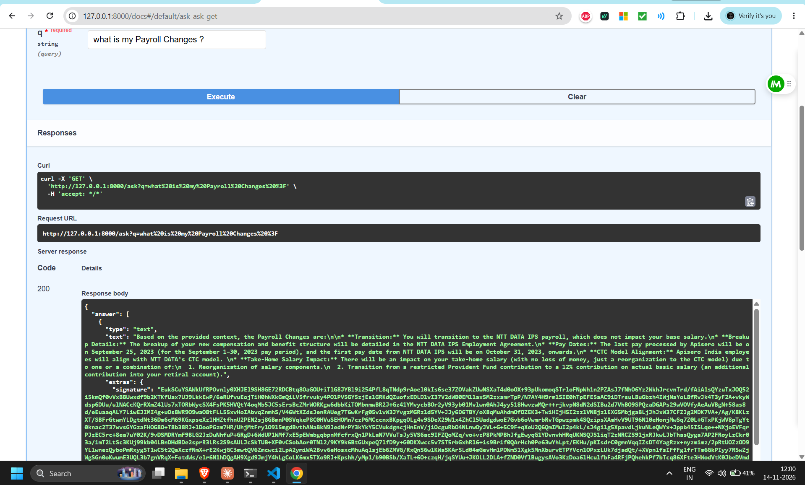
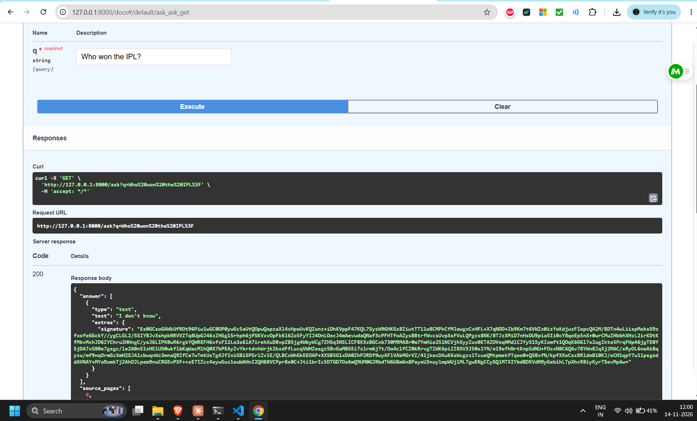

# 📄 PDF Q&A Chatbot (RAG)

Ask questions about any PDF in plain English and get answers grounded in the document, with the page numbers they came from.

Built with **Python, LangChain, Google Gemini, ChromaDB and FastAPI**.

---

## 🧠 How it works

```
            INGESTION (run once)                         QUERY (every question)
 ┌─────────┐   ┌──────────┐   ┌────────────┐      ┌──────────┐   ┌───────────┐   ┌─────────┐
 │ data.pdf│ → │  Chunks  │ → │ Embeddings │ ──→  │ ChromaDB │ → │ Top-4     │ → │ Gemini  │ → Answer
 └─────────┘   │ 1000 ch, │   │  (Gemini)  │      │ (vector  │   │ chunks +  │   │  LLM    │   + source pages
               │ 100 ovlp │   └────────────┘      │   DB)    │   │ question  │   └─────────┘
               └──────────┘                       └──────────┘   └───────────┘
```

1. **Load** – `PyPDFLoader` reads the PDF page by page.
2. **Chunk** – `RecursiveCharacterTextSplitter` splits text into 1000-character chunks with 100 characters of overlap, so sentences at the edges aren't lost.
3. **Embed** – each chunk becomes a vector with `gemini-embedding-001`. Chunks with similar meaning get vectors that sit close together.
4. **Store** – vectors are saved in a local **ChromaDB** (`db/` folder).
5. **Retrieve** – the user's question is embedded the same way, and the 4 most similar chunks are fetched.
6. **Generate** – the chunks and the question go to Gemini with a strict prompt: *answer only from this context, otherwise say "I don't know".*
7. **Serve** – FastAPI exposes it as `GET /ask?q=...` and returns the answer plus source pages.

---

## 📸 Results

**1. Question answered from the PDF** – *"What is my Payroll Changes?"*
The answer comes only from the document's content, with source pages returned.



**2. Question not covered by the PDF** – *"Who won the IPL?"*
The bot says **"I don't know"** instead of making something up. This is the hallucination guard working.



---

## 🔧 Problems I hit and how I solved them

| Problem | What happened | Fix |
|---|---|---|
| **No API credits** | OpenAI returned `429 – no credits remaining` | Switched to Google Gemini's free tier. Thanks to LangChain, only the embedding and LLM classes changed; the rest of the pipeline stayed the same. |
| **Rate limit** | Gemini free tier allows 100 embedding requests per minute, and the PDF had more chunks than that | Batched ingestion: 90 chunks at a time with a 61-second pause between batches. I also raised the chunk size to 1000 to reduce the chunk count (64 chunks). |
| **Hallucination** | LLMs can confidently make things up | Context-only prompt with an "I don't know" fallback, temperature 0, and source pages returned for verification. |
| **Slow or hanging requests** | API retries made `/ask` hang | Added `timeout=30` and `max_retries=1` so it fails fast. |
| **Messy answer format** | Newer Gemini models return `content` as a list of parts with a `signature` field instead of plain text | Extracted only the `text` parts so the API returns a clean answer string. |
| **Wrong Python interpreter** | `ModuleNotFoundError` even though packages were installed | PowerShell was using the global Python. Running `.\venv\Scripts\python.exe` used the venv. |

---

## 🚀 Run it yourself

```bash
git clone https://github.com/<your-username>/pdf-chatbot.git
cd pdf-chatbot
python -m venv venv
venv\Scripts\activate            # Mac/Linux: source venv/bin/activate
pip install -r requirements.txt
```

Create a `.env` file:
```
GOOGLE_API_KEY=your-gemini-key   # free at aistudio.google.com
```

Put a PDF in the folder as `data.pdf`, then:
```bash
python ingest.py                 # builds the vector DB
uvicorn app:app --reload         # starts the API
```

Open **http://127.0.0.1:8000/docs** and try `/ask`.

---

## 🛣️ What's next

- **Hybrid search** (BM25 + vectors) for better keyword matches
- **Reranker** to reorder retrieved chunks by relevance
- **RAGAS evaluation** – faithfulness, answer relevance, context precision
- **Chat memory** for follow-up questions
- **Multiple PDFs** with metadata filters
- **Simple UI** with Streamlit
- **Agentic version** – let the LLM decide when to search the docs and when to use other tools

---

## 📚 Tech stack

| Layer | Tool |
|---|---|
| Language | Python |
| Orchestration | LangChain |
| Embeddings | Google `gemini-embedding-001` |
| LLM | Google Gemini Flash |
| Vector DB | ChromaDB |
| API | FastAPI + Uvicorn |
